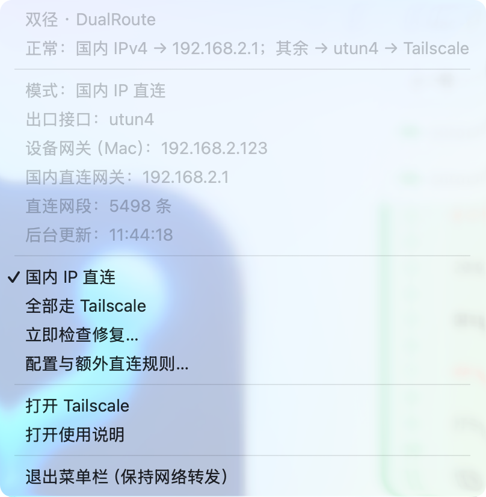

# 双径 · DualRoute

**国内访问走家庭宽带，国外访问走 Tailscale 出口。**

双径提供 macOS 菜单栏工具和 QWRT / OpenWrt 旁路由插件，解决使用 Tailscale VPS 出口时，国内流量也绕行海外、访问变慢的问题。

旁路由版由软路由统一接管家庭设备的网络，Mac 和手机无需各自连接 Tailscale；Mac 版则可让 Mac 承担网关角色。设备将网关和 DNS 指向承担转发的设备，即可共享分流出口。

[发布下载](https://github.com/lulalulaluobo/DualRoute/releases) · [旁路由版说明](docs/openwrt-usage.md) · [Mac 版说明](docs/usage.md)

## 可以做什么

- **国内 IP 直连**：国内 IPv4 流量走家庭宽带，其余流量走 Tailscale。
- **选择 VPS 出口**：旁路由版可选择 Tailnet 中可用的出口节点。
- **一键切换模式**：旁路由版在 Tailscale 分流与 OpenClash 之间互斥切换；Mac 版支持国内直连或全部走 Tailscale。
- **共享给局域网设备**：以软路由或 Mac 为网关的手机等设备，也能使用分流出口。
- **保留子网访问**：旁路由版支持子网广播和接受远端子网路由，方便从外部访问家庭设备。
- **查看运行状态**：查看出口、设备和流量；旁路由版还提供当前连接、DNS 查询及服务日志。
- **添加直连规则**：按需补充需要直接访问的 IPv4 地址或网段。
- **自动恢复配置**：自动识别 Tailscale 接口变化，在连接条件满足后恢复转发规则。

## 界面预览

## 当前版本

- **旁路由版**：提供 IPK，已在 QWRT 23.05 / iptables legacy（fw3）验证，依赖系统已有的 Tailscale；尚未适配 fw4/nftables。
- **Mac 版**：适用于 Apple Silicon Mac，需配合已部署的 Tailscale 和分流后台使用；DMG 提供菜单栏控制应用。

目前按 **IPv4 地址**分流，尚不支持完整 Clash 配置导入、域名或进程精准分流。国内网站如果解析到海外地址，仍可能经过 Tailscale。
